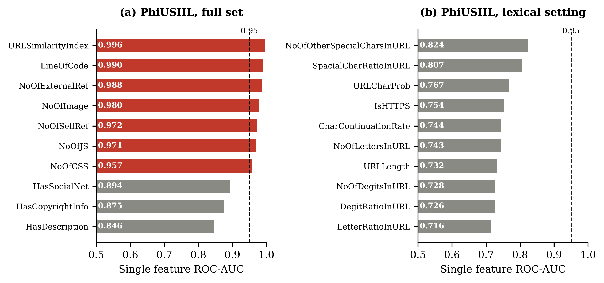

# Shortcut Features and Fair Evaluation in Phishing URL Detection

Code, results and figures for the paper:

> **Shortcut Features and Fair Evaluation in Phishing URL Detection: A Statistical Comparison of Stacking Ensembles and Hybrid Feature Selection**
> Nadia Mahmood Hussien, Mustansiriyah University, Baghdad, Iraq.

The study audits the PhiUSIIL phishing URL dataset for shortcut features, defines a lexical evaluation setting without strong single feature shortcuts, and reassesses a stacking ensemble (Random Forest, XGBoost, LightGBM with a logistic regression meta-learner) and a hybrid Mutual Information plus RFECV feature selector with significance testing on two datasets.

## Key results

| Finding | Value |
|---|---|
| Single feature ROC-AUC of URLSimilarityIndex (PhiUSIIL, full set) | 0.996 |
| Decision tree accuracy on the full PhiUSIIL feature set | 100.00% |
| Highest single feature ROC-AUC in the lexical setting (21 URL features) | 0.824 |
| Test F1, stacking vs best single model, PhiUSIIL lexical | 99.74% vs 99.73% (XGBoost) |
| Test F1, stacking vs best single model, WPD | 96.60% vs 96.95% (LightGBM) |
| Stacking vs XGBoost or LightGBM (10-fold CV, Holm adjusted) | not significant on either dataset |
| Stacking training time relative to XGBoost and LightGBM | 18 to 52 times longer |
| Features removed by MI + RFECV selection | 38% (PhiUSIIL), 41% (WPD) |



## Repository structure

```
notebooks/phishing_shortcut_evaluation.ipynb   full experiment pipeline (Colab ready)
scripts/corrected_tests.py                     corrected resampled t-test and Holm adjustment (Table 10)
scripts/make_paper_figures.py                  Figures 2, 3 and 4 of the paper
results/tables/                                all result tables (CSV and Excel) from the reported run
results/figures/                               figures produced by the notebook
results/environment.json                       software versions of the reported run
figures/                                       paper figures (300 dpi)
data/README.md                                 how to obtain the two datasets
```

## Data

Both datasets are public; see [`data/README.md`](data/README.md).

* **PhiUSIIL** (235,795 URLs): UCI Machine Learning Repository, dataset 967. Downloaded automatically by the notebook.
* **WPD, Web page phishing detection** (11,430 URLs, 87 features): Mendeley Data, doi:10.17632/c2gw7fy2j4.3.

## How to run

1. Open the notebook in Google Colab:
   [](https://colab.research.google.com/github/Nadi-989/phishing-shortcut-evaluation/blob/main/notebooks/phishing_shortcut_evaluation.ipynb)
2. Upload `dataset_phishing.csv` (see `data/README.md`) to the Colab file panel.
3. `Runtime → Run all`. A CPU instance is enough; the full run takes about 60 to 90 minutes.

Locally:

```bash
pip install -r requirements.txt
jupyter notebook notebooks/phishing_shortcut_evaluation.ipynb
python scripts/corrected_tests.py
python scripts/make_paper_figures.py
```

All random operations use `RANDOM_STATE = 42`.

## Method summary

1. Preprocessing fitted on the training split only (stratified 80/20 split).
2. Shortcut analysis: ROC-AUC of every feature on its own; features above 0.95 are shortcut candidates.
3. Lexical setting for PhiUSIIL: 21 features computed from the URL string; URLSimilarityIndex and page content counts are excluded.
4. Hybrid feature selection: Mutual Information filter (top 60%) followed by RFECV with a Random Forest.
5. Models: logistic regression, decision tree, naive Bayes, Random Forest, XGBoost, LightGBM and a stacking ensemble.
6. Evaluation: test split metrics (accuracy, precision, recall, F1, ROC-AUC, MCC, FPR, time), ablation, and 10-fold CV with the corrected resampled t-test and the Wilcoxon signed-rank test, Holm adjusted.

## Citation

If you use this code, please cite the paper (citation details will be added after publication) and the two datasets:

* A. Prasad and S. Chandra, "PhiUSIIL: A diverse security profile empowered phishing URL detection framework based on similarity index and incremental learning," *Computers & Security*, vol. 136, 103545, 2024.
* A. Hannousse and S. Yahiouche, "Towards benchmark datasets for machine learning based website phishing detection: An experimental study," *Engineering Applications of Artificial Intelligence*, vol. 104, 104347, 2021.

## License

MIT, see [`LICENSE`](LICENSE). The datasets are distributed by their authors under their own licenses.
